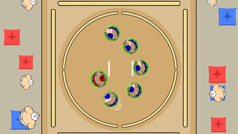
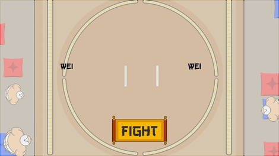
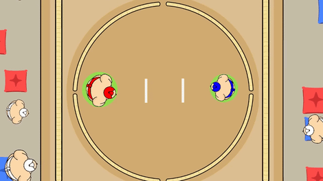

# Knock Konck!

[Try the game on itch.io](https://mathiscblt.itch.io/knock-knock)



A cozy percussive 2D arcade sumo brawler made in Unity.

Step into the arena! *Push*, *bounce*, and *outmaneuver* your opponent to knock them out. Whether you want to test your skills in a **Tournament** or challenge a friend in **2-Player Local Mode**, every match is a fast-paced, physics-driven showdown.

> **Theme: Lucky Number**

Before entering the arena, **your fate is decided by your Lucky Number.**

It dynamically shapes your sumo wrestler's **10 core attributes**: *Weight*, *Size*, *Aura*, *Force*, *Stamina*, *Cooldown*, *Awkwardness*, *Fatigue*, *Inertia*, and *Delay*. Will your lucky number turn you into an immovable giant or an agile fighter? Adapt your playstyle to your number and claim victory!


---

## Game modes

- **Tournament (vs. AI):** Climb the ranks against AI opponents in Normal or Hard difficulty.
- **2-Player (Local 1v1):** Share the keyboard and battle a friend on the same screen.

## Controls

### Tournament mode

| | Choice 1 | Choice 2 | Choice 3 |
|---|---|---|---|
| **Move** | WASD / ZQSD | Mouse | Arrow Keys |
| **Dash** | SpaceBar | WASD / ZQSD | Right Shift |

### 2-Player mode

| | Player 1 | Player 2 |
|---|---|---|
| **Move** | WASD / ZQSD | Arrow Keys |
| **Dash** | SpaceBar | Right Shift |



## Credits & assets

- **Art & Visuals:** All visual assets were hand-crafted from scratch during the game jam.
- **Audio & Music:** Sound effects and background music sourced from Pixabay.
- **Audio Management:** Powered by BroAudio for Unity.


## Project structure

```
Assets/
├── Scripts/
│   ├── GameFlow/     Screens, sessions, match lifecycle
│   ├── Gameplay/     Sumo physics, combat, controllers, balance, camera
│   └── UI/           Panels, menus, typewriter, button sounds
├── Prefabs/          Sumo, PlayerSumo, AiSumo, GameArea, SumoSetupPanel1
├── Scenes/           SampleScene (game), Training (ML-Agents)
├── Audios/           Sound effects and music clips
├── BroAudio/         Audio framework (third-party)
├── Animations/, Materials/, Visuals/, Settings/, TextMesh Pro/
```

### GameFlow

- **`GameFlowManager`**: the single entry point for screens. It shows one panel at a time, starts fights, reacts to fight results, and drives the music.
- **`GameSession`**: For managing the tournament : gets Player's Lucky Number and draw the opponents numbers.
- **`MatchManager`**: spawns the fighters, tracks who is alive and detects the end of a fight..
- **`SumoSetup`**: the data of one fighter (lucky number, color, AI or player, controls).
- **`GameMode`, `Difficulty`**: enums for VsAi / LocalMulti and Normal / Hard.

### Gameplay

- **`SumoMovement`**: the core of a fighter. It runs the dash state machine (`Normal → Windup → Dashing`), the dash cooldown, and the stun state, and applies forces to the Rigidbody2D.
- **`SumoHealth`**: health. At 0 HP the sumo is stunned for `stunDuration`, then recovers at full health.
- **`SumoVisuals`**: animator triggers, blinking while stunned, squash on elimination, and dash ghosts (`DashGhost`).
- **`SumoUI`**: the dash cooldown and health bars above each sumo.
- **`SumoCamera`**: follows the fighters, using Cinemachine.
- **`AreaChecker`**: leaving the arena eliminates the sumo.
- **`PlayerAction`**: reads input for a human sumo (scheme chosen in the setup screen).
- **`AiAction`**: AI controller (see [AI](#ai)).
- **`SumoBalanceConfig`** and **`SumoData`**: manage sumo data balancing.
- **`LockRotation`**: keeps the UI upright.

### UI

- **`UIPanel`**: base class for all panels (`Show`, `Hide`, and `FadeIn`).
- **`MainMenuPanel`**, **`ControlSchemePanel`**, **`SetupPanel`**, **`SumoSetupPanel`**, **`StatsPanel`**, **`MatchResultPanel`**, **`TournamentRoundPanel`**, **`TournamentEndPanel`**.

### Others 

- **`SelectionHighlighter`**: highlights the selected option in each group of buttons.
- **`UIButtonSound`**: hover, select and click sounds, added automatically to every button at startup.


## AI

`AiAction` runs every frame and does two things.

**Movement** (by priority):
1. If it is near the edge of the arena, it steers back toward the center.
2. If the player is dashing, it dodges sideways.
3. If it is lighter than its target, it backs off when too close and circles at medium range.
4. Otherwise, it moves straight toward its target.

**Dash:**
- No dash during cooldown.
- No dash if the estimated landing point would leave the arena. This check also applies to dodges.
- Dodges when the player is dashing.
- Otherwise, it dashes when the target is in range and it is facing the target.

## Audio

- Sounds and music are audio assets managed with **BroAudio**.


## Notes

- The project was made in solo during a the official 2026 Unity game jam. 

